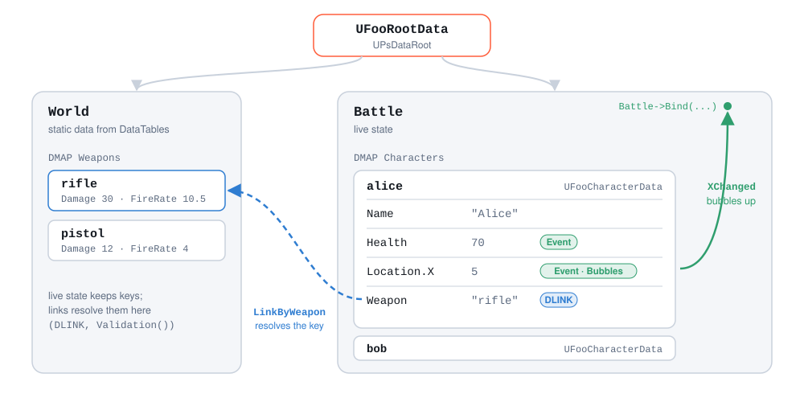

<p align="center">
  <picture>
    <source media="(prefers-color-scheme: dark)" srcset="docs/assets/psdata-wordmark-dark.svg" />
    
  </picture>
</p>

<p align="center">
  <strong>A reactive data model for Unreal Engine.</strong><br />
  Declare game state, configs and protocol messages as typed C++ classes —<br />
  get events that bubble, links between branches, JSON and binary for free.
</p>

<p align="center">
  <a href="docs/getting-started.md">Get started</a> &nbsp;|&nbsp;
  <a href="#features">Features</a> &nbsp;|&nbsp;
  <a href="docs/cookbook.md">Cookbook</a> &nbsp;|&nbsp;
  <a href="#documentation">Docs</a> &nbsp;|&nbsp;
  <a href="#ai-agents">AI agents</a>
</p>

<p align="center">
  <a href="#compatibility"></a>
  <a href="docs/dev/testing.md"></a>
  <a href="docs/blueprints.md"></a>
  <a href="LICENSE"></a>
</p>

Games keep a lot of data that is not actors: the player's profile, the match state, balance tables,
settings, the messages exchanged with a backend. PsData gives that data one home — a tree of typed
objects you declare in a few lines of C++ — and makes the tree **observable**: every change can be
heard where it happened or anywhere above it, links resolve keys into the right branch, and any
node serializes to JSON or binary and loads back with a patch.

It was built at Pushkin Studio and runs in production: in **DAWG**, a competitive tactical shooter,
the client, the dedicated server and the meta-server protocol all speak one PsData model.

## A model in a few lines

```cpp
UCLASS()
class UFooCharacterData : public UPsData
{
	GENERATED_BODY()

public:
	DPROP(FString, Name);

	DMETA(Event, EventStorage)      // changes are broadcast, with the previous value
	DPROP(int32, Health);

	DMETA(Strict)                   // always allocated, never null
	DPROP(UFooPointData*, Location);

	DARRAY(FString, Tags);

	DPROP(FString, Weapon);         // a key...
	DLINK(UFooWeaponProto*, Weapon, World.Weapons);  // ...resolved into static data

protected:
	virtual void InitProperties() override
	{
		Health = 100;
	}
};
```

```cpp
UFooCharacterData* Alice = RootData->Battle->Characters[TEXT("alice")];

Binds.Add(Alice->Health.Bind(FPsDataDelegate::CreateLambda([Alice](UPsDataEvent* Event) {
	const auto Change = Alice->Health.GetEventStorage(Event);
	UE_LOG(LogTemp, Log, TEXT("%s: %d -> %d"), **Alice->Name, Change->GetPreviousValue(), Change->GetValue());
})));

Alice->Health -= 30;                                   // "Alice: 100 -> 70"
const int32 Damage = *Alice->LinkByWeapon.Get()->Damage; // follows Weapon into World.Weapons

FPsDataFastJsonSerializer Serializer;                  // the whole battle, as one JSON string
RootData->Battle->DataSerialize(&Serializer);
```

No `UPROPERTY`, no getters and setters, no `OnRep`, no hand-written JSON: the macros generate the
storage, accessors, events, reflection for the serializers and the Blueprint nodes.

<p align="center">
  <picture>
    <source media="(prefers-color-scheme: dark)" srcset="docs/assets/model-dark.svg" />
    
  </picture>
</p>

## Features

**Typed properties, zero boilerplate.** `DPROP(int32, Health)` is a member you assign, compare
and increment like an `int32` — and it knows its owner, its key on the wire and its event name.
Numbers, strings, names, text, enums, vectors, colours, curves, soft references, fixed-point and
big integers, arrays and string-keyed maps of any of them, and child data.
→ [`docs/model.md`](docs/model.md)

**Events that bubble.** Mark a field `Event` and every change is broadcast synchronously, with
the previous value if you ask for it. Add `Bubbles` and one listener on the battle hears every
character's position change. Collections announce `Added` and `Removed`; every object coalesces
its edits into one deferred `Changed`, which is what saving and UI refreshes hang on.
→ [`docs/events.md`](docs/events.md)

**Links instead of pointers.** Live state stores keys; `DLINK` resolves a key through a path from
the root into a map, caches the result and re-resolves when either side changes. `Validation()`
lists every dangling key in the tree without crashing — run it after loading data or in a cook.
→ [`docs/model.md`](docs/model.md)

**Any node to JSON or binary, and back.** Fast JSON for save games and HTTP, the engine's JSON DOM,
binary for snapshots inside RPCs. Load with a patch to apply only what a server sent. Content hashes
tell you whether anything really changed; `Copy()` deep-copies a subtree.
→ [`docs/serialization.md`](docs/serialization.md)

**DataTables for designers.** `MAKE_TABLE_STRUCT` generates a row struct for a data class.
Designers fill a normal DataTable; one call loads every row into a map in the tree.
→ [`docs/serialization.md`](docs/serialization.md#datatables)

**Blueprints without glue.** Every field gets Get/Set nodes, every link a node, every collection a
proxy, and Bind offers a dropdown of every event that can reach the object. `ReadOnly` and
`DPROP_CONST` remove the setters where only code may write.
→ [`docs/blueprints.md`](docs/blueprints.md)

**Deterministic numbers.** `FPsDataFixedPoint` parses `"10.5"` exactly and computes the same on
every machine; `FPsDataBigInteger` goes past 64 bits. Both serialize as exact strings.

## Production patterns

The [cookbook](docs/cookbook.md) has the shapes DAWG runs on, reduced to the pattern:

- **One root, mutation by role** — `DPROP_CONST` gives one subsystem write access to a branch,
  everyone else a const view.
- **Static data from DataTables, validated at cook time.**
- **Settings that save themselves** — one `Changed` listener, gated by the content hash.
- **Server-to-client snapshots** — a binary subtree inside any RPC.
- **A backend protocol made of data classes** — requests and responses round-trip through JSON;
  responses patch the live tree.
- **Actors that mirror data** — replicate a key, bind to the data, die with it.

## Install

PsData is a source plugin; your project must be a C++ project.

```bash
cd <YourProject>/Plugins
git clone https://github.com/PushkinStudio/PsData.git
```

Enable it in `Edit → Plugins` (or `"Plugins": [{ "Name": "PsData", "Enabled": true }]` in the
`.uproject`), add `"PsData"` to your module's `PublicDependencyModuleNames`, and
`#include "PsDataAPI.h"`. The first editor launch compiles the plugin.

Use a copy or a clone, not a symlink: Unreal Build Accelerator aborts on symlinked plugin folders.
To keep the checkout outside your project, point `AdditionalPluginDirectories` in the `.uproject`
at the folder *containing* `PsData`.

**Build the model after PsData is ready.** Its reflection compiles at `PostEngineInit`, which in a
packaged game comes *after* `UGameInstance::Init`; create model objects from
`FDataDelegates::PostDataModuleInitPromise.Bind(...)`. [Details](docs/getting-started.md#4-build-the-model--after-psdata-is-ready).

## Documentation

| Page | What it answers |
| --- | --- |
| [Getting started](docs/getting-started.md) | **Start here.** Install, declare a model, give it a root, read, write, observe, save. |
| [Model](docs/model.md) | Every macro, meta tag and supported type; the tree API; the rules that are enforced with fatal errors. |
| [Events](docs/events.md) | Which event fires when, bubbling, the deferred `Changed`, holding events back. |
| [Serialization](docs/serialization.md) | Formats, patching, content hashes, DataTables, validation, schema, replication. |
| [Blueprints](docs/blueprints.md) | The nodes the editor generates and how to bind from a graph. |
| [Cookbook](docs/cookbook.md) | Production patterns, end to end. |
| [Changelog](CHANGELOG.md) | What changed, including the UE 5.8 port. |

## AI agents

The model is plain C++ headers — one greppable line per field — which suits coding agents. The
mistakes that matter compile cleanly and then do nothing or stop the game at run time, so the
docs spell them out for agents:

- **[`docs/ai-guide.md`](docs/ai-guide.md)** — for an agent writing game code *with* PsData: the
  fourteen rules (events need `Event` meta, map-key alphabet, links need a root, when the model may
  be built, …) and how to verify a change. Paste this into your project's `CLAUDE.md` / `AGENTS.md`:

  ```markdown
  Game data uses the PsData plugin (reactive data model, Plugins/PsData). Before declaring or
  changing data classes, read Plugins/PsData/docs/ai-guide.md and Plugins/PsData/docs/model.md.
  ```

- **[`AGENTS.md`](AGENTS.md)** — for an agent working *on* the plugin: one command to build and
  test, the layout, the rules for changes. `CLAUDE.md` imports it.
- **[`llms.txt`](llms.txt)** — an index of the docs and the key sources for LLM tools.

## Compatibility

| Engine | Status |
| --- | --- |
| UE 5.8 | Verified on 5.8.1: editor, Game and Shipping targets build with no plugin warnings; 15/15 tests pass. |
| UE 5.6 | Verified on 5.6.1: editor target builds with no plugin warnings; 15/15 tests pass. |
| UE 5.7 | Not verified here; the version guards cover it. |
| Earlier | The source keeps upstream's compatibility branches back to 4.24; they are not re-verified. |

Verified on Linux. The plugin has no platform-specific code.

## Testing

```bash
Tools/test.sh /path/to/UnrealEngine
```

Builds the plugin in a generated host project for that engine and runs the `PsData.*` automation
suite — 15 tests over a miniature game model. Windows steps and coverage:
[`docs/dev/testing.md`](docs/dev/testing.md).

## License

MIT — see [`LICENSE`](LICENSE). Created by Nikolay Prudnikov at Pushkin Studio; with Vladimir
Alyamkin, Maxim Fedorenko, Anton Rassadin and Aleksey Ilyin.
